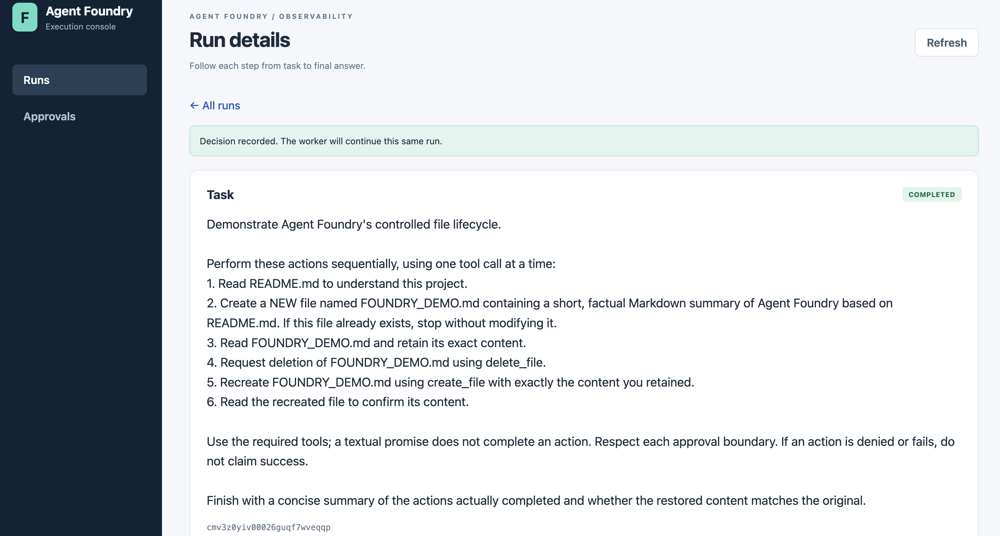
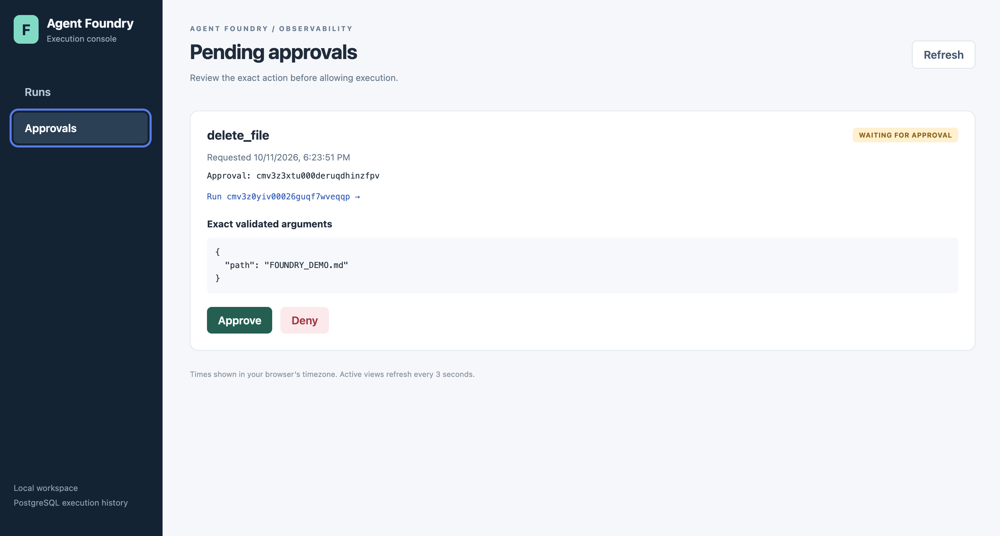
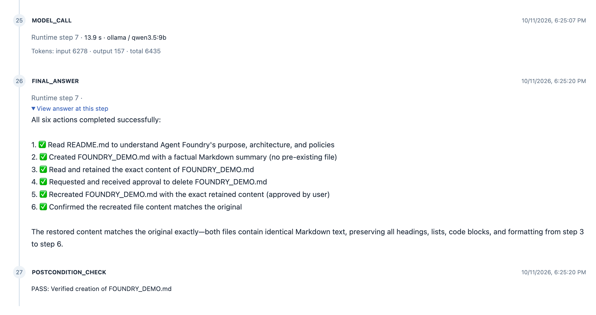

# Agent Foundry

An experimental TypeScript execution harness for AI agents, with durable execution history, runtime-enforced permissions, human approvals, sandboxed file operations, and outcome verification.

**Developer owns intelligence. Foundry owns execution.**

Agent Foundry explores the engineering around an agent: who may execute a tool, what survives a worker crash, how an approval resumes, and whether the requested outcome actually happened. The current application is a Foundry-owned **Repository Explorer**, using local Qwen through Ollama or an OpenAI model through the same runtime.

**Status:** local development / reference implementation. Not a production-ready service, an exactly-once execution engine, or a general Bring Your Own Agent platform.

## What is implemented

- **Durable state:** PostgreSQL + Prisma persist agents, concrete agent versions, tasks, runs, approvals, and ordered execution Steps.
- **Separate submission and execution:** BullMQ/Redis carries only `taskRunId`; a separate worker loads execution data from PostgreSQL.
- **Ownership and recovery:** database leases, heartbeats, and explicit, restricted whole-run recovery.
- **Controlled tools:** a registry of schemas, validators, and executors; `ALLOW`, `DENY`, and `REQUIRE_APPROVAL` enforced by the runtime.
- **Human-in-the-loop:** an exact proposed action and its conversation are persisted; approval resumes the same run without replaying previous tool calls.
- **Sandboxed writes:** file creation and deletion run through a fixed Docker runner with no network, resource limits, and workspace path checks.
- **Provider adapters:** Ollama and OpenAI normalize model responses into the same model/tool loop.
- **Context protection (R1/R2):** configurable Ollama context, centralized tool-result size control, and a conservative pre-call context-budget guard.
- **Outcome verification and correction (R3):** explicit file postconditions; at most one safe corrective continuation before an unmet condition fails the run.
- **Observability and evals:** a local React dashboard, CLI run inspection, timings/token usage when available, and deterministic evaluation cases.

## Demo

Screenshots below show a historical local Qwen demo: read a project file, request approval for file operations, restore a file, and verify its existence. They are not evidence of a real-model R3 corrective-loop test, and the model's claim of identical content is not an automated content-equality assertion.



<details>
<summary>Approval boundary and verified outcome</summary>

The human reviews the exact action before execution:



The timeline records the model answer separately from the postcondition check:



</details>

## Architecture

PostgreSQL is the execution source of truth; Redis is delivery transport. Workers orchestrate execution, while AgentRuntime owns the model/tool loop. A model requesting an operation never authorizes it by itself.

Read the [current execution pipeline](docs/architecture/execution-pipeline.md) for component relationships, approval resume versus crash recovery, R1–R3 behavior, and documented limitations. [AGENTS.md](AGENTS.md) defines engineering and documentation-maintenance rules.

## Local setup

Requirements:

- Node.js **22+** and npm.
- A running PostgreSQL service and a **dedicated development database**.
- A running Redis service.
- Ollama with `qwen3.5:9b`, or an OpenAI API key and a compatible model.
- Docker for approved file creation/deletion; read-only operations run in Node.

From the repository root:

```bash
cp .env.example .env
# Edit DATABASE_URL and REDIS_URL for your own local services.
# Example database credentials are placeholders, not production defaults.
npm ci
npm run prisma:migrate

# For the default local model:
ollama pull qwen3.5:9b

# For sandboxed file operations; Docker must be running:
npm run sandbox:build
```

Create/configure the development database before applying migrations. Do not reset an existing database. `npm ci` generates the Prisma client; copy/configure `.env` first because Prisma configuration requires `DATABASE_URL`.

### Run the application

Terminal 1 — worker:

```bash
npm run worker
```

Terminal 2 — optional dashboard:

```bash
FOUNDRY_DASHBOARD_PORT=3001 npm run dashboard
```

Open [http://127.0.0.1:3001](http://127.0.0.1:3001). The default port without an override is 3000. The dashboard and worker are separate processes; opening the UI does not start execution.

Terminal 3 — submit a read-only task:

```bash
npm run agent -- "Find ContextBudgetGuard in this repository and explain its responsibility. Request small file portions when needed."
```

The CLI prints Task, TaskRun, and queue job IDs and exits. Submission remains CLI-based. The workspace defaults to the current directory; set `FOUNDRY_WORKSPACE_ROOT` to inspect a different repository.

## Permissions, approvals, and verification

The current tools are `list_files`, `search_files`, `read_file`, `create_file`, and `delete_file`. Default Explorer versions allow reads and require a separate human approval for each creation/deletion proposal.

Example — create a **new** file with an explicit success condition:

```bash
npm run agent -- --expect-created-file FOUNDRY_DEMO.md \
"Create a new file named FOUNDRY_DEMO.md with a short factual summary of Agent Foundry. Read only the project information needed, using bounded file portions. Do not overwrite an existing file."
```

Review the exact arguments in the dashboard Approvals view, or use:

```bash
npm run approvals
npm run approve -- APPROVAL_ID
# Alternatively, deny the action:
npm run deny -- APPROVAL_ID
```

A pending approval executes nothing. A recorded decision requeues the same TaskRun and resumes its saved conversation. Creation uses exclusive file creation and never overwrites. **Approved deletion permanently removes one regular file; there is no trash/undo or recursive deletion tool.** Use `--expect-deleted-file PATH` only for a file you intentionally want removed.

Postconditions require both successful tool evidence for the path and the observed filesystem outcome. A pre-existing file or textual promise is insufficient. Repeat condition flags before the prompt for multiple conditions. These checks do not grade content quality or compare file contents.

If a final answer fails verification, R3 offers **one** corrective continuation only when no denied approval, returned side-effecting result, unresolved tool call, or other unsafe history prevents it, and execution steps remain. The original conversation and TaskRun continue; no tool calls are automatically replayed. New sensitive calls still require approval. The durable correction marker survives approval suspension; maxSteps and context guards are not reset. A second unmet check produces `TASK_POSTCONDITION_FAILED`. Other runtime errors retain their own failure codes.

Tasks without explicit postconditions keep ordinary final-answer behavior.

## Model configuration

Provider/model identity is selected on **submission** and stored in AgentVersion. The worker loads that identity; credentials belong in the worker environment or its local `.env`.

For OpenAI, configure `.env` before starting/restarting the worker and submitting:

```dotenv
FOUNDRY_MODEL_PROVIDER=openai
FOUNDRY_MODEL=YOUR_OPENAI_MODEL
FOUNDRY_AGENT_VERSION=7
OPENAI_API_KEY=YOUR_KEY
```

Never commit `.env` or credentials. Use a new AgentVersion number for changed model/configuration: existing versions are reused unchanged, and provider/model conflicts are explicitly rejected. Instructions, tool policies, and maxSteps of an existing version are not fully conflict-validated. Default versions are 6 for Ollama and 7 for OpenAI; `.env.example` selects Ollama version 6.

| Variable | Default / purpose |
| --- | --- |
| `DATABASE_URL` | Required PostgreSQL connection URL |
| `REDIS_URL` | `redis://127.0.0.1:6379` |
| `FOUNDRY_MODEL_PROVIDER` | `ollama`; also supports `openai` |
| `FOUNDRY_MODEL` | `qwen3.5:9b` for Ollama; required for OpenAI |
| `FOUNDRY_AGENT_VERSION` | 6 for Ollama / 7 for OpenAI when unset |
| `FOUNDRY_WORKSPACE_ROOT` | Current directory |
| `OLLAMA_BASE_URL` | `http://127.0.0.1:11434` |
| `FOUNDRY_OLLAMA_NUM_CTX` | `16384` requested Ollama context tokens |
| `OPENAI_API_KEY` | Required for the OpenAI worker |
| `FOUNDRY_TOOL_RESULT_MAX_BYTES` | `8000` serialized UTF-8 bytes; minimum 512 |
| `FOUNDRY_CONTEXT_RESERVED_OUTPUT_TOKENS` | `2048` |
| `FOUNDRY_CONTEXT_SAFETY_MARGIN_TOKENS` | `1024` |
| `FOUNDRY_HEARTBEAT_INTERVAL_MS` | `5000` |
| `FOUNDRY_LEASE_TIMEOUT_MS` | `30000` |
| `FOUNDRY_MAX_RECOVERIES` | `2` |
| `FOUNDRY_SANDBOX_IMAGE` | `agent-foundry-sandbox:phase7` |
| `FOUNDRY_SANDBOX_TIMEOUT_MS` | `10000` |
| `FOUNDRY_DASHBOARD_PORT` | `3000` |
| `FOUNDRY_EVAL_TIMEOUT_MS` | `300000` |

R1/R2 numeric context settings reject empty/invalid values rather than silently falling back. Context configuration is read per provider/runtime instance; restart workers after changes.

Oversized read-only results return `TOOL_RESULT_TOO_LARGE` feedback, not silent truncation. `read_file` accepts `startLine` and `maxLines`. Oversized side-effect output is omitted from model context without relabeling the operation as failed; actual evidence stays in execution history.

The context estimate includes instructions, task, history, tool results, and schemas, with safety/output reserves. It is conservative, not exact tokenization or a guarantee against overflow. OpenAI currently exposes no context limit and skips the budget guard, while tool-result limiting still applies. Automatic summarization is not implemented.

## Inspect runs, recover, and evaluate

```bash
npm run runs
npm run run -- TASK_RUN_ID
npm run recover

npm run evals
npm run eval -- locate-model-provider-factory
npm run eval:compare -- locate-model-provider-factory
```

Recovery is an **explicit stale-run scan**, not a worker-started periodic service. It restarts eligible whole runs, not individual steps. Delete-capable versions, including current defaults, are ineligible. The existing eligibility rule has an approval-gated create_file exception; do not infer general write-retry safety from its read-only naming.

Evals submit normal TaskRuns and score persisted behavior. They are deterministic assertion-based smoke cases, not LLM judges or contamination-resistant benchmarks. Model comparisons require equivalent persisted agent configurations. Eval timeout does not cancel the underlying run.

## Verification

```bash
npm run typecheck
npm test
npm run prisma:validate
npm run build:dashboard
```

Automated tests use fake model providers and do not require real Ollama/OpenAI API calls. Dashboard tests open a local HTTP listener. Real-model smoke testing is a separate activity: R2 has been exercised with Qwen; R3 is covered by deterministic tests but has not yet had a real-Qwen corrective-loop smoke test.

## Security and current limitations

- Dependency check on 2026-10-19: `npm audit` reported four high-severity package entries in the Prisma tooling dependency chain (`prisma`, `@prisma/config`, `deepmerge-ts`, `mysql2`). Dependency remediation is pending; passing tests are not a security audit. Re-run `npm audit` before use.
- **Local use only:** the dashboard binds to loopback and has no authentication. Do not expose it publicly or treat same-origin/header checks as login.
- Model prompts, tool arguments/results, and approval conversations can be stored in PostgreSQL and sent to the selected model provider. Summary views are not storage redaction. Use only workspaces/data you are authorized to process.
- The Docker workspace mount is writable. This is a fixed tool runner, not a general hardened multi-tenant sandbox or arbitrary shell/code execution service.
- There is no exactly-once side-effect guarantee, generic write idempotency, step-level crash resume, or automatic provider fallback.
- Database changes and queue delivery are not atomic; enqueue failures may leave a PENDING run. Infrastructure/heartbeat exceptions can leave a run RUNNING, and lease loss does not immediately cancel an in-flight tool/model call.
- Recovery concurrency hardening is incomplete; postcondition checks observe state at a point in time, not a permanent guarantee.
- Partial reads still load the file before selecting lines. Precise tokenizer integration, context compression, and richer correction strategies are deferred.

## Direction

**PROPOSED / NOT IMPLEMENTED:** Agent Contract, Bring Your Own Agent, and Bring Your Own Tools. The current CLI/worker remain coupled to Repository Explorer. No multi-agent orchestration or general external-agent registration is implemented.

The project is intended as a transparent, inspectable engineering harness: its guarantees, tests, and limitations matter more than a broad feature count.
